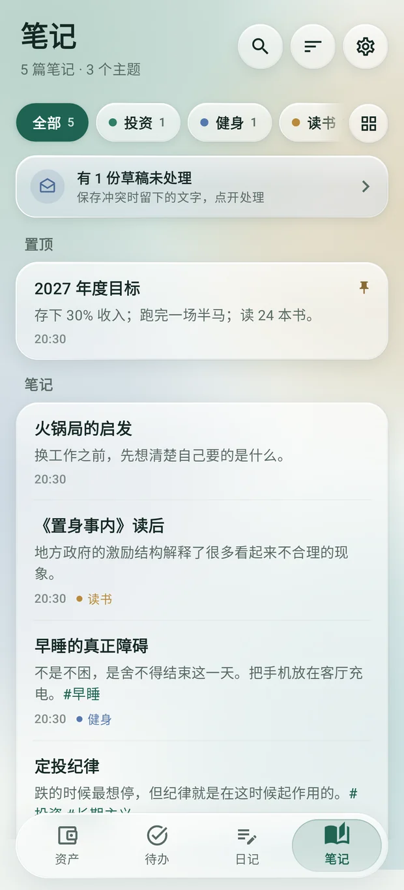
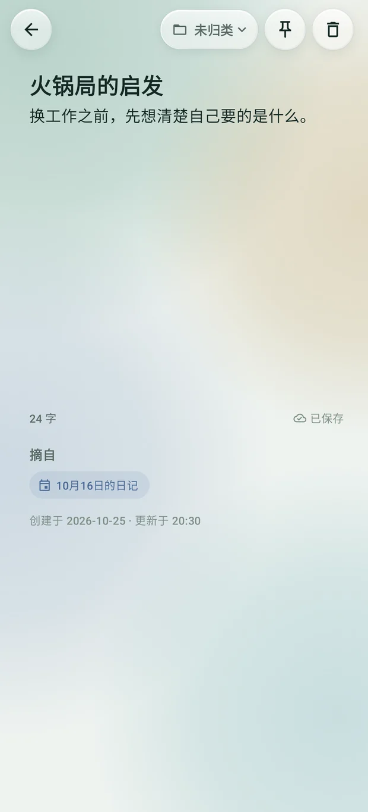
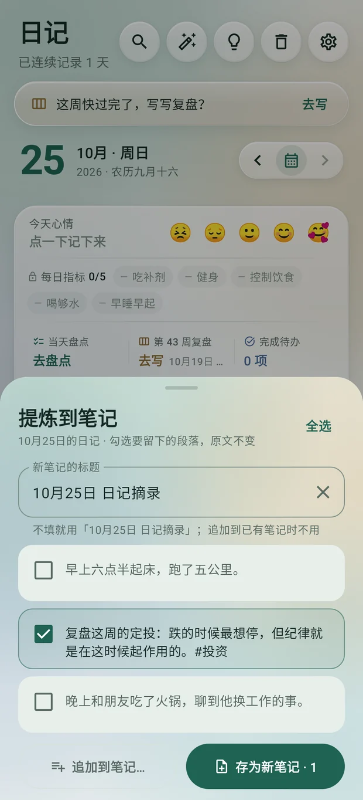
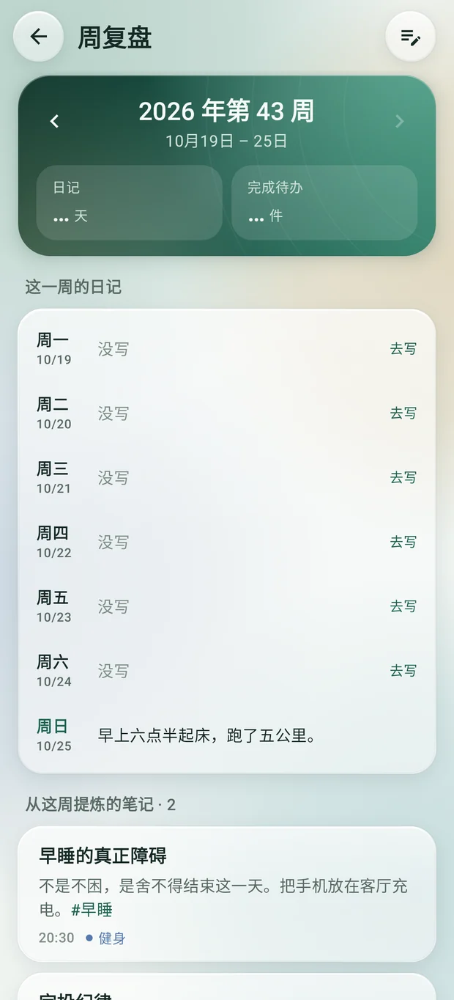

<div align="center">


# 日盈 Gain · OpenAssetBoard

*Act every day, gain every day.*

**A local-first Android app: a personal asset board, a Things-style todo manager, a one-entry-a-day diary, and notes.**

Open it and you know exactly what you're worth; jot down what you have to do today and what happened today. No account, no cloud, no ads by default; sign in to your own server when you want sync.

[](https://github.com/konghw-git/OpenAssetBoard/releases/latest)
[](LICENSE)
[](#install)
[](#stack)

**English** · [简体中文](README.md)

</div>


## Why another money app

Most expense trackers want you to **log every transaction**. Plenty of people actually work the other way: once a month (or once a week) they open an app, correct each account's balance to the truth, and look at whether net worth went up or down. That's the whole workflow.

This app is built for it. One stocktake walks every account, you change the three or five that moved, and you save — the goal is **under 60 seconds**. On top of that, investment accounts record buys, redemptions and dividends with a cumulative P&L that doesn't lie to you. When you do want to log a bill, pull the page down, and the account's balance moves with it. Todos and a diary put "what I have to do today" and "what happened today" into the same local database.

| It is | It is not |
|---|---|
| Net worth and allocation the moment you open it | Useless until you log every transaction |
| Batch stocktakes, edit balances inline; pull down to log a bill when you want | Budgets, imported bank statements |
| Investment flows, net invested, cumulative P&L | Market data feeds, auto valuation, rates of return |
| Things-3-style todos with reminders that actually fire | Tags, teams, pomodoro timers |
| One plain-text diary a day, with lunar date, weather and the day's achievements | Images, rich text |

## Features

### Assets

- **Net worth**: net worth, total assets / liabilities, debt ratio, accounts grouped with subtotals, a small allocation ring inside the net worth card; groups fold to their subtotal and open to show each account.
- **Savings goal**: set a target net worth on the net worth card; it shows a progress bar, what is left, and roughly how long at the pace of the last half year's stocktakes.
- **Stocktake**: edit every account inline, touch only the ones that moved, backfill historical dates; each stocktake becomes a point on the net worth line.
- **Trend**: 3 months / 6 months / 1 year / all time, with period high, low, change and change ratio; a bar-and-line chart of assets vs liabilities.
- **Investment accounts**: buy, redeem, dividend, transfer, repay, borrow, external in/out. Fees have a payer, so the P&L arithmetic stays honest. Market value and net invested drawn as two lines.
- **Account management**: groups, icons (built-in marks for common banks, payment apps and funds), an include-in-net-worth switch, suspend, "locked until" dates, moving the baseline earlier. In an open group, swipe an account left to dissolve it (an account with records is suspended instead; both undo), right to change its balance right in the row.
- **Bookkeeping**: pull the assets page down to record a bill: spending or income, the amount on keys of its own (+ and − add a receipt up), a category in a tap, the account and day guessed from the last one; "again" saves and stays open for the next. Each bill moves its account's balance, and a later stocktake still has the last word. A card on the assets page shows the month's spending, the last seven days and the latest bills; the bills page shows a month by category and by day, tap to edit, swipe left to delete, both with undo.
- **Cash at hand**: the counted accounts minus investments and locked balances, shown in the net worth card with a bar splitting assets into cash / locked / invested; tapping it lists every cash account.
- **Health as an asset**: weigh in once a day, record weight (body fat optional), and follow weight, body fat and BMI with a 7-day average; BMI and body-fat grades, fat and lean mass, progress to a target and a nine-cell body type. A day without a weigh-in simply stays empty — no interpolation, no streaks.
- **Food and energy**: most food needs only a guessed kcal, with every nutrient optional; with a label, copy it (energy and the rest per 100 g/ml, then how much you had) and kJ turns into kcal by itself. Anything eaten before refills in one tap. The resting rate (BMR) is estimated from the profile and weight, so each day shows the share of it eaten and the deficit with no exercise, and the last seven days their intake. It records; it sets no targets.
- **Home-screen widgets**: four glass widgets that follow the system light/dark theme and resize freely. The asset board shows net worth, the change since the last stocktake, its line and the groups behind it, with a one-tap stocktake and an eye that hides amounts; Today ticks a todo off in place (tap again to undo) and opens a sheet over the home screen to rename, flag, push to tomorrow or delete; Notes edits a note right there, saved as you type; Countdown shows the days to the days that matter, birthdays repeating yearly. Settings → 桌面小组件 places any of them in one tap.

   

### Todo

- **Things 3 structure**: inbox → today → upcoming → someday, plus lists with sections. Items carry deadlines, an important flag, notes and checklists; checklist items hang like nodes on a thread under the todo's card and tick with one tap.
- **Drag todos**: hold the title and drag to reorder. Today is in your own order alone, so overdue and important todos can go anywhere; near an edge the list scrolls, faster the nearer and longer you wait, without ever losing the row; in a list, dragging across a section title moves the todo into that section. Up and down only reorders; to merge into another todo's checklist, drag below it and slide right (the badge names the target), with undo. A stationary long press selects; selected companions move together.
- **Drag checklist items**: hold an item's text to reorder it or place it between another todo's items. The other items make room as it moves, so the gap shows where it lands; dragging near the list edge scrolls automatically. Moves preserve the item's text and checked state and can be undone. In the detail page, hold the drag handle to reorder while the text remains editable.
- **List cards**: one card per row on phones and unfolded screens, with the deadline below the name. Swipe left to archive or right to delete, both with undo; hold and drag to reorder. Todo date tags appear below the title, before the reminder, and wrap when space is tight.
- **Tidy a selection**: reschedule, move or delete it, make it the checklist of a new todo (named in place, undoable), or add it to an existing todo's checklist; a todo with a checklist can be dissolved back into separate todos.
- **A radial dial**: the home screen puts views on a wheel with live counts, one tap to switch; today's daily habits sit beside it.
- **Daily habits**: supplements, workout, diet, water and early sleep to start with; tap 每日 to rename, restyle, write a rubric (one condition a line), reorder, add (up to seven) or remove them. Tap to tick on the todo page, hold to float the rubric until you let go; shown read-only in the diary's day card, each day with the habits it had.
- **Reminders that fire**: normal notifications, a strong reminder (full screen, ring, vibrate — still on time in deep doze), per-occurrence reminders for repeating todos, catch-up after reboot, and recovery after the permission is revoked. Choose an on-time reminder or 5, 15 or 30 minutes, 1 or 2 hours, or a day early in the todo details.
- **Quick capture**: tap `+` on the widget, type, save — target under 5 seconds.
- **Swipe actions**: swipe left to delete (the card breaks into dust; a small capsule at the bottom offers undo), right for complete, reschedule and the important flag; checklist items swipe away on their own. A swipe on a row works the row; the tabs turn from anywhere off the rows, or by sliding along the bottom bar. Pull the list down for a new todo, the assets page for a new bill.
- **Trash and logbook**: deleted todos, lists, diary entries, weekly reviews and notes stay for 30 days; completed occurrences of repeating todos stay in the logbook.

   

### Diary

- **One plain-text entry per day**, automatically annotated with the lunar date, solar term, public holidays and make-up workdays, the day's weather, and the todos and stocktake you completed. You write straight on the page, with no box around the text.
- **Nothing gets lost**: a save lands one second after you stop typing, and at least every 4.5 seconds while you type without pausing. A failed save says so and keeps your text in the editor.
- **Calendar and search**: browse by month, search every entry, and revisit the same day in past years.
- **Weekly review**: one per week, on the diary's timeline. The page opens with the week in numbers (diary days, daily habits, todos done, change in weight and net worth), then the week's seven entries and the notes taken from them, and the review itself at the bottom, saved as you type. Weight compares the two weeks' average weigh-ins; net worth uses account balances, including inline edits and flows, excluding the opening balance of newly tracked accounts. Each diary day links to its week, Monday and Sunday evening bring a nudge, and the calendar marks every week.

   

### Notes

- **The diary goes by day, notes go by topic**: one idea per note, revised and grown over time. The first line is the title; `#tags` are highlighted.
- **Extract from the diary**: tap the light bulb on a diary day and tick paragraphs, or select some text and pick 提炼到笔记 from the selection menu; save it as a new note (titled after the day unless you type one) or append it to one. The original is untouched; the note remembers where it came from and takes you back there. Weekly reviews extract the same way.
- **Today's review**: each day one note left alone the longest comes back to the top of the list.
- **One level of topics**: a row of filters with a fixed button at its end that opens every topic in a grid (searchable once there are many); search every note.
- **Order and swipes**: long-press a note to drag it (or sort by last updated or created); swipe left to delete, right to pin or move to a topic. Each note is a clear glass card, its topic and time at the end of the title line over two lines of text, as on the home screen widget; the glass is clear or deep (a setting). Pull the list down to start a new note.
- **Never loses text either**: the diary's autosave and conflict-to-draft rules; unsaved notes are committed before a restore.

   

### Shared

- **Local first**: everything lives in SQLite on the phone by default. The backup is one JSON file written to a folder you pick and overwritten each time.
- **Optional account and sync**: an administrator creates the account on your own server. Before signing in, the app checks that the server is reachable and shows the round trip, so a blocked network gets a "change networks" message instead of a long wait. Once you sign in, the whole backup is synced over HTTPS to that server; the account page can change the password with the old one, which signs other devices out and keeps this one signed in. One phone can switch between accounts, each with its own local database; without signing in, everything stays local. Conflicts are never merged automatically — you choose which copy to keep. See [`server/README.md`](server/README.md).
- **Versioned backup and restore**: format v13, reads v1–v12. Restore replaces the whole database, copies the current data aside first, and runs behind a write gate so an in-flight old operation can't land in the restored data.
- **Networking is optional and one switch away**: turn it off and the app makes no request at all — holidays come from built-in data and no weather is shown.
- **Glass throughout**: every page sits on a few fields of colour that bloom in as it opens; cards, chips and buttons are translucent panes with a lit rim, and the tab bar is frosted glass floating over the pages. The net worth card is warm glass, amber, coral and persimmon drifting slowly under it and a spark of light running round its edge. The glass is clear or deep (a setting).
- **Motion**: cards arrive one after another and tilt toward a holding finger, a ticked box spreads a ring of the theme colour, the net worth rolls up from zero as the overview opens, pages rise in from the right, and the tab bar's highlight glides with the pager.
- **Ink green, mineral neutrals and champagne accents**, with dark mode, system theme, adjustable up/down colours and a two-pane layout on foldables.
- **A clearer asset overview**: separate net worth, allocation and account details, with less repeated information and adaptive layouts for narrow screens, large text and large amounts.
- **In-app updates**: Settings › 应用更新 downloads the latest GitHub release, checks its signature and hands it to the system installer, keeping your data; checks once a day by default, can be turned off.
- **Launcher shortcuts** straight to stocktake, quick capture and the diary.

<details>
<summary>More screenshots</summary>

<br>

   

   

   

   

 

</details>

## Install

Download the latest `OpenAssetBoard-x.y.z.apk` from [Releases](https://github.com/konghw-git/OpenAssetBoard/releases/latest) and open it on the phone (you'll need to allow installing from unknown sources).

- **Android 10 (API 29) and up.**
- The app is written for Chinese Android phones (vivo, Xiaomi, OPPO and friends). **Reminder punctuality depends on background permissions**: after installing, open Settings → reminder setup and follow the checklist for autostart, background running, notifications and exact alarms. It works without Google services.
- There is no store listing. From 0.8.0 the app upgrades itself from Settings › 应用更新 (download, signature check, a backup first, then the system installer); older versions need one manual install. Download mirrors come preset (GitHub itself and a few accelerators common on the mainland), timed and picked in a tap.
- The launcher name is 「日盈」 (Gain; 「强者之路」 before 0.9.0) and the package is `com.assetboard`; the repository is OpenAssetBoard. Same app.

> ⚠️ This is a personal project, not audited financial software. Try it with a few days of test data before you trust it with real balances, and back up regularly.

## Data and privacy

- **By default, the contents of your assets, todos and diary stay on the phone.** Every feature works without an account; there is no telemetry and no advertising.
- **Account sync is an optional, self-hosted service.** Only after you sign in is the whole backup JSON uploaded over HTTPS to **your own server**. Snapshots on that server are plaintext (no end-to-end encryption), and an administrator creates the accounts; signing out keeps the data on the phone. Without signing in, nothing is sent to a server.
- Every write goes through a write gate (`WriteGate`): restores reject new writes while they run, and an operation carrying a stale data epoch cannot write into restored data.
- **Networking is on by default**, but you can switch it off. It is used only for:
  - To attach the day's weather when you write a diary entry, rough coordinates go to [Open-Meteo](https://open-meteo.com/) (open, no API key). Coordinates only — never your text.
  - From November each year, a weekly check for next year's public holidays: one public JSON from [NateScarlet/holiday-cn](https://github.com/NateScarlet/holiday-cn).
  - Update checks: at most once a day, the latest release's details from this repository; the APK is downloaded only when you ask. Nothing is uploaded.
  - Syncing after you sign in: only to the server address you enter on the login page. No such request exists while signed out.
- The backup file is plain JSON in a folder you choose, **unencrypted**. Snapshots on the server are unencrypted too; keep the VPS and its backups safe.

## Build from source

JDK 21 and the Android SDK (platform 36 / 37) are required.

```bash
# Installs JDK 21, the Android SDK and Gradle under ~ and accepts the SDK licences (no sudo)
scripts/setup-toolchain.sh
source ~/.local/share/dev-dl/android-env.sh

./gradlew testDebugUnitTest   # every unit test: rules, repositories, restore, migrations, UI
./gradlew assembleDebug       # app/build/outputs/apk/debug/app-debug.apk
```

A release build needs your own key (none is in the repo):

```bash
scripts/create-keystore.sh    # written to your own directory; keep a copy somewhere safe
./gradlew assembleRelease     # app/build/outputs/apk/release/app-release.apk
```

> The debug build uses `com.assetboard.debug`, so it never replaces — or wipes — a release install. Android refuses a release upgrade signed with a different key, and uninstalling clears the local database: back up first.

### Screenshots and baselines

The screenshots are rendered on the JVM by Roborazzi against the real Compose UI; no device needed:

```bash
scripts/dev-test.sh --all      # every test, the screenshots against app/screenshots/ pixel by pixel, then lint
scripts/dev-test.sh --accept   # after an intended UI change: what this run drew becomes the baselines
```

"Today" in the screenshots is one fixed day, so the baselines do not go stale overnight. A fresh clone has no baselines and `--all` lists every image as new: `--accept` once. `scripts/publish-release.sh` runs the same `--all` before a release. The images in `docs/images/` are those PNGs scaled down and converted to WebP; `scripts/dev-test.sh --brand` redraws the banner.

## Stack

| | |
|---|---|
| Language / UI | Kotlin 2.4, Jetpack Compose, Material 3 |
| Architecture | MVVM with `StateFlow`, a hand-written `AppContainer` (no DI framework) |
| Storage | Room, with exported schemas committed and explicit migrations 1 → 2 → … → 12 |
| Background | WorkManager, AlarmManager, a foreground service |
| Home screen | Jetpack Glance widgets |
| Charts | Hand-drawn on Canvas, no chart library |
| Lunar calendar | [cn.6tail:lunar](https://github.com/6tail/lunar-java) plus built-in official holiday tables |
| Tests | JUnit and Robolectric, including Roborazzi screenshot tests |
| Minimum | Android 10 (API 29) |

## Layout

```
app/src/main/java/com/assetboard/
├── domain/           pure rules: balances, net invested, P&L, net worth trend, health grades and trend, todo views and recurrence, lunar calendar
├── data/             the only way in: validation, transactions, the write gate, backup and restore, migrations
├── ui/               Compose screens (assets / todo / diary / notes / settings); components holds the charts and shared widgets
├── reminder/         alarms, notifications, the strong-reminder ring service, full-screen alarms, boot catch-up
└── widget/           Glance home-screen widgets
```

The rule is **calculation out of the UI**: every number on screen comes from a pure function in `domain/`, and every write in `data/` happens inside one transaction, with constraints enforced by `Rules.kt` and the repositories. That is why the core rules can be tested on the JVM without a device.

| File | What |
|---|---|
| `domain/Ledger.kt` | Balance, net invested, P&L, stocktake totals |
| `domain/health/` | BMI, body-fat grades, body type, health trend and moving average |
| `domain/todo/` | View membership and ordering, recurrence, reminder state, invariants |
| `data/WriteGate.kt` | The read-write gate and the data epoch |
| `data/BackupManager.kt` | JSON export (v13, reads v1–v12), validation, restore coordinator |
| `domain/calendar/` | Lunar calendar, solar terms, festivals, the official workday table |

## Roadmap

- [x] Asset overview, stocktake, net worth trend, investment flows
- [x] Todos, diary, daily habits, trash
- [x] Backup / restore, reminders, widgets
- [x] Health as an asset (weight, body fat, BMI), cash at hand
- [x] Food energy log (label conversion, daily deficit)
- [x] Notes: one level of topics, extracted from the diary, traced back to their day, searchable
- [x] Today's note review, extracting a selection, weekly review
- [ ] One search across diary, weekly reviews and notes; `[[links]]`
- [ ] Rates of return (XIRR, money-weighted annualised)
- [ ] Target allocation comparison
- [ ] Credit-card statement and due-date reminders
- [ ] Automatic valuation from shares × NAV
- [ ] App lock

## Going deeper

Rules written down can be argued with. These are the answers to "why is it calculated that way":

- [Calculation rules](docs/calculations.md) — balances, net invested, cumulative P&L, net worth trend, and why a fee is counted once
- [The write gate and the data epoch](docs/write-gate.md) — why an operation from before a restore cannot land in restored data
- [How reminders stay on time](docs/reminders.md) — exact alarms, strong reminders, recovery after a permission is revoked, tokens
- [Backup and restore](docs/backup-format.md) — the file format, atomic replacement, whole-database restore
- [Health](docs/health.md) — one record a day, missed days, anchored periods, where the grade tables come from

## Contributing

Issues and pull requests are welcome, and so is a note in [Discussions](https://github.com/konghw-git/OpenAssetBoard/discussions) about how you actually use the app. See [CONTRIBUTING.md](CONTRIBUTING.md) first:

- `./gradlew testDebugUnitTest` passes.
- Rule changes belong in the pure functions under `domain/` with a test, not in the UI layer.
- Changes to the data model or the backup format also update `app/schemas/` and the migration tests.
- UI copy is hard-coded Chinese for now; multi-language UI is not planned. The two READMEs are the exception.

Security reports go through [SECURITY.md](SECURITY.md).

## Credits

- [6tail/lunar-java](https://github.com/6tail/lunar-java) — lunar calendar, solar terms and festivals (MIT)
- [NateScarlet/holiday-cn](https://github.com/NateScarlet/holiday-cn) — Chinese public holiday and workday data
- [Open-Meteo](https://open-meteo.com/) — free weather and geocoding APIs
- Account icons include the trademarks of banks, payment apps and fund companies. They identify the user's own accounts and remain the property of their owners.

## Licence

[Apache License 2.0](LICENSE)
